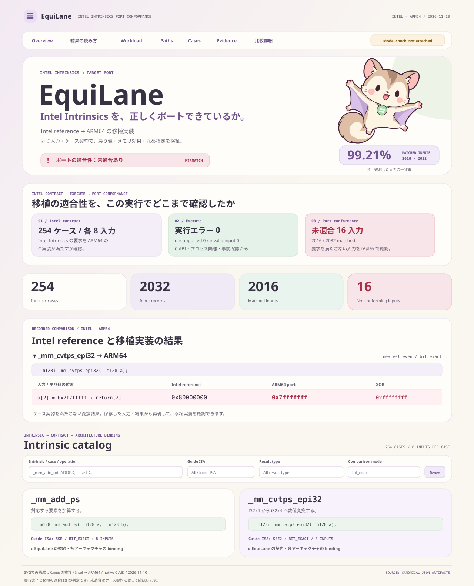

# EquiLane

[日本語](README.md) | [English](README.en.md)

**Verify that Intel Intrinsics have been ported correctly to other CPUs.**

EquiLane uses the Intel Intrinsics Guide and results from the Intel implementation as its reference.
It checks whether the OpenPOWER, ARM64 NEON, and RISC-V RVV ports reproduce the required behavior.
The repository includes 268 operations, input generation, bit-level comparison, mismatch replay, and HTML reports.

**The 268 operations do not cover the entire Intel Intrinsics Guide.** EquiLane registers 268 of the 7,126 names in Guide 3.6.9.
There are 78 unregistered SSE names excluding SVML, and 46 unregistered SSE2 names.
The [coverage audit and missing-name lists](documentation/intrinsic-coverage.json) count aliases and macros as separate names.

[Published guide and reports](https://yuna-r.github.io/EquiLane/index.en.html)

## Compare all four environments

The shared verification environment is **Ubuntu 26.04 LTS in Docker**.
Install Docker and Buildx, then run this command from the repository root.
The [Docker guide](docker/guide.en.json) explains how to enable emulation for other CPUs.

```sh
./docker/run.sh all
```

This builds each image, runs the C implementations, and compares their results with Intel.
The first run takes longer while compilers and other dependencies are installed. When it finishes, open:

```text
artifacts/docker/pipeline-report.html
```

| Target | Instruction set used by the C implementation | Docker platform |
|---|---|---|
| Intel | SSE2 | `linux/amd64` |
| OpenPOWER | POWER8 / VSX | `linux/ppc64le` |
| ARM64 | NEON | `linux/arm64` |
| RISC-V64 | RVV 1.0 | `linux/riscv64` |

The host CPU's architecture runs directly; other architectures run through an emulator.
Emulated results are recorded as observations from that execution environment.
They are not measurements from a collection of four physical CPU systems.

## Read results using the Intel Intrinsics Guide

For an intrinsic such as `_mm_add_pd`:

1. Check its prototype and Operation in the Guide to understand its arguments, return value, and behavior.
2. Open EquiLane's [add-f64x2 case](10_official_suite/cases/add-f64x2.py) to see the input types, comparison rule, and symbols for each target.
3. Find that case in the report and compare the Intel and target outputs. For a mismatch, inspect the input, expected bits, and observed bits.

The Guide's intrinsic names are mapped to EquiLane case IDs and implementation symbols.
The Guide's ISA requirements and each port's required ISA are recorded separately.
NaN signs and payloads, signed zero, and other bit-level differences remain visible in the results.

**Exit code 1 means that results differed from Intel within the tested input set.**
Inspect the port to determine why it does not satisfy the behavior required by the case contract.
Execution errors, unsupported cases, and invalid inputs are reported separately; first check which outcome occurred.

## Input counts and execution paths

`all` runs both of these paths:

| Path | Default input count | Main artifacts |
|---|---:|---|
| Call raw C wrappers directly | 268 operations × 3 inputs = 804 per target | `<role>/outputs.jsonl`, `compare-<role>.json` |
| Pass JSON inputs through the shared C ABI | 265 operations × 8 inputs + 3 setzero inputs = 2,123 per target | `native/<role>/`, `canonical/compare-<role>/` |

The shared C ABI path checks CPU and floating-point settings before running isolated workers.
It retains build evidence and traceability linking each case, symbol, input, and result.
On Docker hosts other than RISC-V, both VLEN 128 and VLEN 256 are checked.
`pipeline-summary.json` contains machine-readable counts and stage outcomes.

To search more thoroughly for porting errors, select the `adversarial` profile:

```sh
EQUILANE_PROFILE=adversarial ./docker/run.sh all artifacts/adversarial
```

By default this runs **135,427 inputs per target**, about 63.8 times the usual eight-input setting.
It generates 512 inputs for 264 operations. The three `setzero` operations have one unique input each. For `_mm_set1_epi8`, whose only input is an 8-bit value,
it checks all 256 possible inputs.
The inputs cover integer overflow boundaries, individual bits and lane order, ±0, subnormals,
NaN signs and payloads, conversion and rounding boundaries, every declared immediate value,
and unaligned memory with guard regions. All targets receive the same inputs, making port mismatches reproducible against Intel.

The input artifact's `adversarial-coverage.json` records its hash, the number of included scenarios in each category,
and missing boundary values. A 512-input run does not exhaust every possible combination.
Add a setting such as `EQUILANE_COUNT_PER_CASE=2048` to include more inputs.
Input coverage and the proportion of C execution results that match Intel are separate measurements.
Every mismatch is checked and retained in `differences.jsonl`.
Detailed HTML entries and individual replay bundles are limited to the first 128 per comparison by default.

To run the test stages as well:

```sh
./docker/run.sh verify
```

`verify` adds CMake/CTest for each CPU, Python regressions, browser behavior checks, sanitizers, and cross builds.
The portable model has known NaN and rounding mismatches. These remain in the results,
so a completed pipeline can still report a nonconforming overall result.

## Use the development interface

```sh
docker compose up --build studio
```

Open [localhost:8765](http://localhost:8765) to generate inputs and view reports.
Studio's `check` command uses the shared Python model as a development fixture.
Use `docker/run.sh` to compare the four C implementations.

You can also install the project directly in Python 3.11 or later:

```sh
python3 -m venv .venv
source .venv/bin/activate
python -m pip install -e .
equilane check --target all --showcase-report
```



## Investigate results and add cases

- [Docker settings and commands](docker/guide.en.json)
- [Development, case authoring, and native replay](documentation/development.en.json)
- [Native features and verification history](documentation/native-status.json)
- [Completion criteria and evidence for the full pipeline](documentation/native-contract.json)
- [Known mismatches in detail](MISMATCH_REPORT.en.json)

The legacy `ioitf` command, Python imports, and `ioitf.toml` are still supported.
Artifact identifiers beginning with `ioitf.*` and the C ABI are retained for compatibility.
The README serves as the package description; detailed specifications and verification records are stored as JSON.

Original concept: [daisukeokaoss](https://github.com/daisukeokaoss) ·
[Specification](https://github.com/daisukeokaoss/ToukaSpecification/blob/a4d888dfdca53d4335a6051bea9df8b9fda9bf35/README.md) · [Apache-2.0](LICENSE)

The specification submodule retains its original MIT license. See [NOTICE](NOTICE) for copyright notices.
