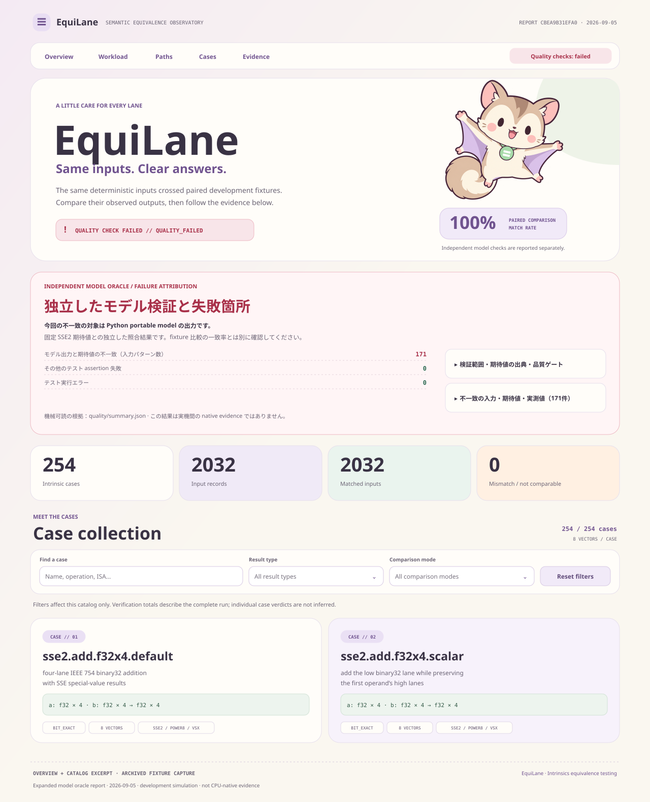

# EquiLane

**Intrinsics Equivalence Testing**

Intel Intrinsics と OpenPOWER・ARM64 NEON・RISC-V64 RVV の実装を、同じ入力で見比べるツールです。
254のケースと、結果をまとめるHTMLレポートを収録しています。



レポートには比較結果、ケース一覧、独立したモデル検証の不一致をまとめています。
ケースを検索して絞り込めます。外部の画像やフォントに依存しない、1ファイルのHTMLです。

## 使う

Python 3.11以上が必要です。

```sh
python3 -m venv .venv
source .venv/bin/activate
python -m pip install -e .

equilane serve
```

[localhost:8765](http://localhost:8765) を開くと、新しい検証を実行し、
過去のレポートも見返せます。画面で比較対象を選べます。出力先は `.equilane/checks/` です。

端末から直接レポートを作る場合：

```sh
equilane check --target all --showcase-report
```

最後に表示される `showcase_report` のHTMLをブラウザで開きます。
`--target arm` / `--target riscv` で個別に指定できます。省略時はOpenPOWERです。

独立したモデル検証、sanitizer、cross buildも含める場合：

```sh
equilane check --project equilane.toml --quality --showcase-report
```

現在のportable modelには、NaNと丸め処理の既知の不一致があります。
`--quality` はこれらをレポートに記録し、検証失敗として終了します。
原因別の件数・ビット差・CPU向け実装の観測は [不一致の詳細レポート](MISMATCH_REPORT.md)、
テストの構成は [バグ探索用テスト](tests/BUG_HUNT.md) にあります。
カバレッジは既定では計測しません。必要な場合だけ上のコマンドに `--coverage` を追加します。

入力を増やして比較する場合：

```sh
equilane check --profile standard --count-per-case 1000 --jobs auto --showcase-report
```

## ケースを追加する

```sh
./10_official_suite/new-case my-add-i32x4 +
```

生成されるPythonファイル1つに、入力の契約とモデルの宣言をまとめています。
ケースの書き方や実機adapterについては [開発・検証ガイド](DEVELOPMENT.md) を参照してください。

## 検証の範囲

通常の比較は共通Pythonモデルを使う開発用fixtureです。各CPUの実機間での一致を示す証拠ではありません。
4環境それぞれに254操作のC実装があり、クロスビルドに対応しています。
ARM64はこのMac上のNEONテスト、RISC-V64はQEMUのRVVテストで動作を確認しています。
実機成果物を収集するnative runnerは引き続き開発中です。

従来の `ioitf` コマンド、Python import、`ioitf.toml` も引き続き使えます。
成果物の `ioitf.*` 識別子とC ABIは、既存データとの互換性のため維持しています。

原案：[daisukeokaoss](https://github.com/daisukeokaoss) ·
[仕様書](https://github.com/daisukeokaoss/ToukaSpecification/blob/a4d888dfdca53d4335a6051bea9df8b9fda9bf35/README.md) · [Native status](NATIVE_STATUS.md) · [Apache-2.0](LICENSE)

仕様書submoduleには元のMITライセンスが適用されます。著作権表示は [NOTICE](NOTICE) を参照してください。
