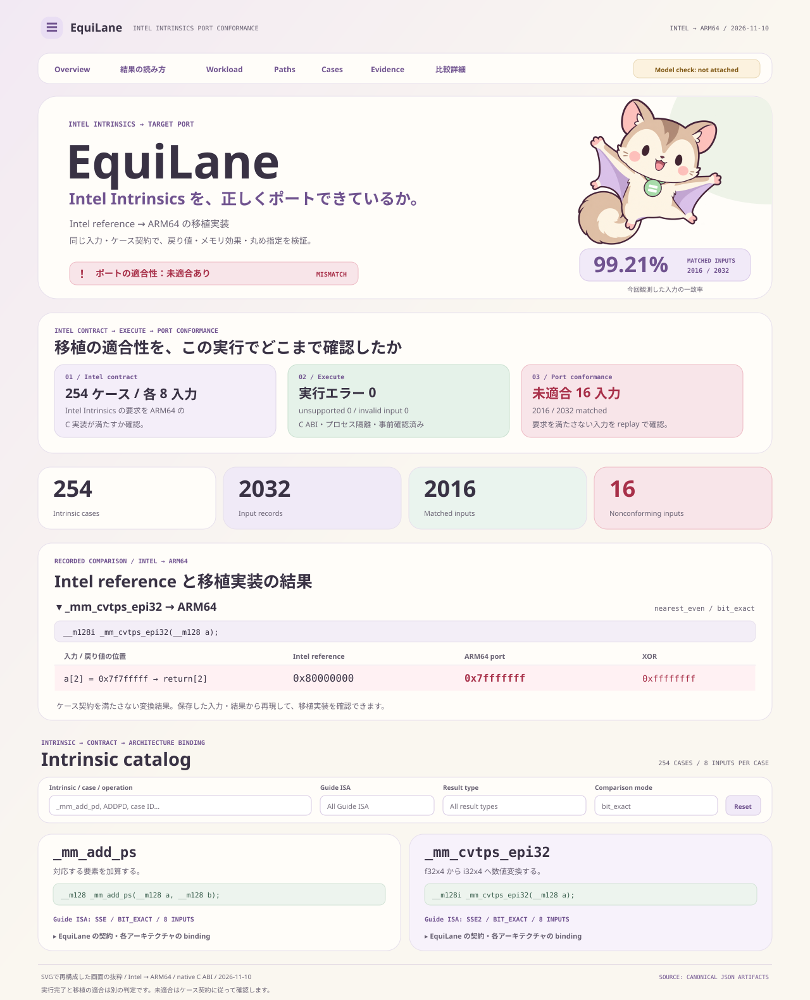

# EquiLane

[日本語](README.md) | [English](README.en.md)

**Intel Intrinsicsが、他のCPU向けに正しくポートされているかを検証するツールです。**

Intel Intrinsics GuideとIntel側の実行結果を基準に、OpenPOWER・ARM64 NEON・RISC-V RVVの
移植実装が同じ振る舞いを再現できているか確認します。268操作の実装、入力生成、ビット単位の比較、
不一致の再実行、HTMLレポートを収録しています。

**268操作はIntel Intrinsics Guide全体ではありません。** Guide 3.6.9の7,126名称のうち268名称を登録しています。
SVMLを除くSSEには未登録78名称、SSE2には未登録46名称があります。別名・マクロも名称ごとに数えた
[収録範囲と未登録一覧](documentation/intrinsic-coverage.json)を公開しています。

[公開ガイド・レポート](https://yuna-r.github.io/EquiLane/)

## 追加1,895候補の実行結果

既存268操作とは別の **SIMDe pure-value拡張1,895候補** を、同じ60,392入力で4環境にかけました。
全候補のビルドと結果採取を完了しています。Intel列はCPU guardを通過した実intrinsicの結果です。

| 環境 | Cを実行できた候補 | `ok`入力 | CPU未対応 |
|---|---:|---:|---:|
| Intel | 552 / 1,895 | 17,540 | 1,343候補・42,852入力 |
| ARM64 | 1,895 / 1,895 | 60,392 | 0 |
| OpenPOWER | 1,895 / 1,895 | 60,392 | 0 |
| RISC-V64 | 1,895 / 1,895 | 60,392 | 0 |

Intelと両方で実行できた17,540入力の戻り値をbyte単位で比較し、ARM64で1,008件、
OpenPOWERで981件、RISC-V64で1,735件のraw差分を記録しました。
近似reciprocal/rsqrtの許容誤差や、castの未定義上位bitについては、各APIの仕様に沿った評価が残っています。
FP例外flagsは診断情報として別に記録しています。実行完了と仕様適合の判定は区別して確認してください。

[ブラウザで読む実行レポート](https://yuna-r.github.io/EquiLane/extended/) · [English](https://yuna-r.github.io/EquiLane/extended/index.en.html)

HTML上で関数を検索し、入力・Intel・移植先の戻り値を確認できます。
[保存版HTML](reports/extended-1895/index.html)と[実測集計JSON](reports/extended-1895/execution-summary.json)も収録しています。

Docker VMM切り替え後の同じUbuntu環境でもAVX-512は公開されず、直接実行するとSIGILLになりました。`QEMU_CPU=max`でも同じで、現在のx86エミュレーションの制限です。[診断記録](documentation/intel-cpu-diagnosis.json)に測定値を保存しています。

Guide全7,126名称の対応は未完了です。masked・FP16・AMXを含むその他の開発は一時停止を維持しています。
[チェックポイントの状態](documentation/pause-status.json)に完了範囲と残作業を記録しています。

## まず4環境で比較する

検証環境は **Ubuntu 26.04 LTS のDocker** に揃えています。
DockerとBuildxを用意し、このリポジトリのルートで実行してください。
異種CPUを動かすための設定は [Dockerガイド](docker/guide.json) にあります。

```sh
./docker/run.sh all
```

各イメージのビルド、C実装の実行、Intelとの比較を行います。
初回はコンパイラなどの準備に時間がかかります。完了後、次のファイルを開きます。

```text
artifacts/docker/pipeline-report.html
```

| 対象 | C実装の命令セット | Docker platform |
|---|---|---|
| Intel | SSE2 | `linux/amd64` |
| OpenPOWER | POWER8 / VSX | `linux/ppc64le` |
| ARM64 | NEON | `linux/arm64` |
| RISC-V64 | RVV 1.0 | `linux/riscv64` |

ホストと同じCPUは直接、異なるCPUはエミュレータで実行します。
エミュレータの結果は、その実行環境での観測として記録します。
全種類の物理CPUを揃えて測定した結果ではありません。

## Intel Intrinsics Guideから結果を読む

たとえば `_mm_add_pd` を調べる場合は、次の順に辿れます。

1. Guideのprototypeで引数と戻り値を、Operationで計算内容を確認する。
2. EquiLaneの [add-f64x2のcase](10_official_suite/cases/add-f64x2.py) で、入力型・比較方法・各対象のsymbolを確認する。
3. レポートでそのcaseを探し、Intelと比較対象の出力を見る。不一致なら入力値・期待ビット・実測ビットを辿る。

Guideのintrinsic名と、EquiLaneのcase ID・実装symbolを対応付けています。
GuideにあるISA情報と、各CPU向け実装の必要ISAはそれぞれ記録します。
NaNの符号・payload、signed zeroなどの差も、そのまま比較結果に残します。

**終了コード1は、検証した範囲でIntel側と一致しない結果が見つかったことを表します。**
ケース契約が要求する振る舞いを満たしているか、移植実装を確認する必要があります。
レポートの実行エラー・unsupported・入力不正は別に表示されるので、まずどの種類の結果か確認してください。

## 何件を、どの経路で調べるか

`all` は、次の2つの経路を実行します。

| 経路 | 既定の入力数 | 主な成果物 |
|---|---:|---|
| raw C wrapperを直接呼ぶ | 268操作 × 3入力 = 804件 / 対象 | `<role>/outputs.jsonl`、`compare-<role>.json` |
| 共通C ABIへJSON入力を渡す | 265操作 × 8入力 + setzero 3入力 = 2,123件 / 対象 | `native/<role>/`、`canonical/compare-<role>/` |

共通C ABIの経路はCPU・FP設定を事前確認し、隔離workerで実行します。
ビルド証跡と、case・symbol・入力・結果を結ぶtraceabilityも保存します。
RISC-V以外のDockerホストでは、VLEN 128 / 256の両方を確認します。
件数と成否の機械可読な集計は `pipeline-summary.json` にあります。

移植の見落としを詳しく探す場合は、境界値を増やした `adversarial` を選べます。

```sh
EQUILANE_PROFILE=adversarial ./docker/run.sh all artifacts/adversarial
```

既定で **1対象あたり135,427入力**、通常の8入力設定の約63.8倍を実行します。264操作は512入力、3つのsetzero操作は各1入力、
入力が8bit値1個の `_mm_set1_epi8` は、存在する全256入力を調べます。
整数の桁あふれ境界・各bit・レーン順序、±0・subnormal・NaNの符号とpayload、
変換や丸めの境界、許可済みの全即値、非整列メモリと前後の保護領域を含めます。
同じ入力を全対象へ渡すため、Intelに対する移植の不一致を再現できます。

入力側の `adversarial-coverage.json` には、実際に含めた入力のhashと、
各検証軸の収録数・未収録の境界値を保存します。512入力で全組合せを網羅したという意味ではありません。
さらに増やす場合は `EQUILANE_COUNT_PER_CASE=2048` などを追加できます。
この収録率と、C実装を実行して一致した割合は別に確認してください。
大量の不一致も全件判定し、`differences.jsonl` へ保存します。
HTMLの詳細表示と個別の再実行用ファイルは、既定では各比較の先頭128件までです。

テスト工程までまとめて実行する場合：

```sh
./docker/run.sh verify
```

`verify` は、各CPU向けのCMake/CTestと、Python回帰、ブラウザ動作、sanitizer、cross buildを追加します。
portable modelにはNaN・丸め処理の既知の不一致があります。これらも検証結果に残すため、
工程が動作していても結果全体が不一致になる場合があります。

## 開発用の画面を使う

```sh
docker compose up --build studio
```

[localhost:8765](http://localhost:8765) で入力生成やレポート表示を試せます。
Studioの `check` は、共通Pythonモデルを使う開発用fixtureです。
4種類のC実装を比較する場合は `docker/run.sh` を使います。

Python 3.11以上の環境へ直接インストールすることもできます。

```sh
python3 -m venv .venv
source .venv/bin/activate
python -m pip install -e .
equilane check --target all --showcase-report
```



## 詳しく調べる・ケースを追加する

- [Dockerの設定と実行方法](docker/guide.json)
- [開発・case追加・native replayの手順](documentation/development.json)
- [native機能と検証の記録](documentation/native-status.json)
- [全工程の完了条件と証跡](documentation/native-contract.json)
- [既知の不一致の詳細](MISMATCH_REPORT.md)

従来の `ioitf` コマンド、Python import、`ioitf.toml` も利用できます。
成果物の `ioitf.*` 識別子とC ABIは互換性のため維持しています。
READMEはパッケージの説明ファイルとして使い、詳細な仕様・検証記録はJSONにまとめています。

原案：[daisukeokaoss](https://github.com/daisukeokaoss) ·
[仕様書](https://github.com/daisukeokaoss/ToukaSpecification/blob/a4d888dfdca53d4335a6051bea9df8b9fda9bf35/README.md) · [Apache-2.0](LICENSE)

仕様書submoduleは元のMITライセンスです。著作権表示は [NOTICE](NOTICE) を参照してください。
